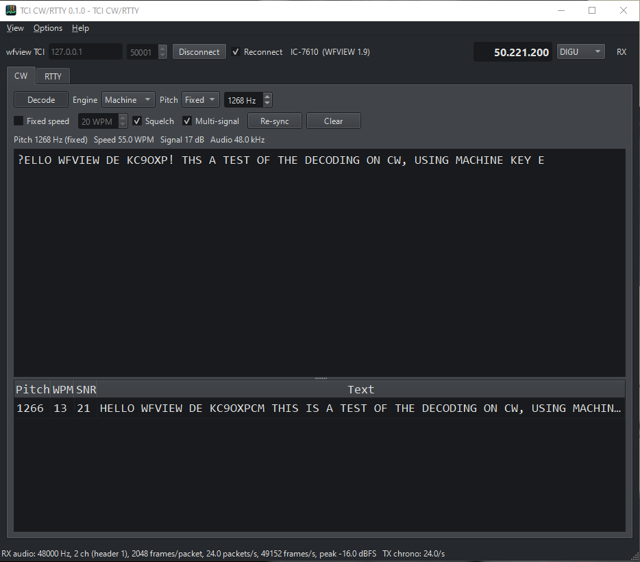
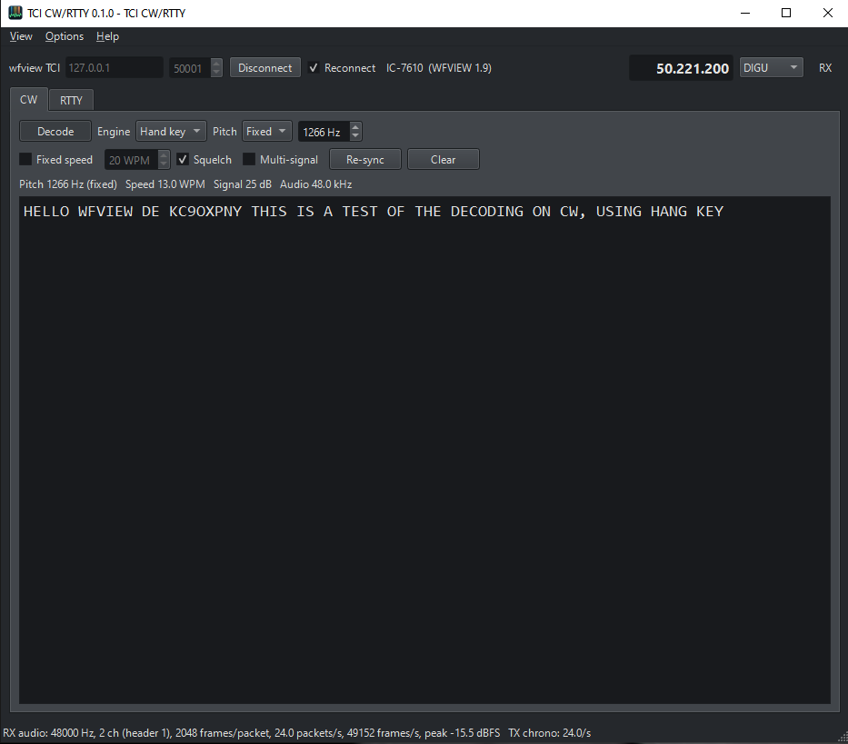

# wfview TCI Digi

> [!WARNING]
> **Alpha release: not fully developed and still very much in testing.**
> Expect bugs, rough edges and changes between versions. It has been tried on one
> station (IC-7610 with wfview v3) so far. When you transmit, start into a dummy load
> or at low power and keep an eye on the radio. Bug reports and test results are
> welcome in the Issues tab.


Stand-alone digital modes - CW, RTTY, PSK (BPSK31/63/125), Feld Hell,
Olivia/Contestia, SSTV, AMTOR FEC, NAVTEX, WEFAX and WWV Time - that connect to **wfview** over **TCI**
(Transceiver Control Interface). wfview handles the radio; this program gets the
receive audio, sends transmit audio, and keys PTT, all through wfview's TCI server.
It works the same whether wfview reaches the radio over LAN or over USB, and it
should work with any other TCI server too.

> **Unofficial companion.** This is not (yet) part of the wfview project. It is
> offered to the wfview team for possible adoption; see *Future* below.

It started as the CW decoder and RTTY window proposed for wfview v3
(wf-group/wfview PRs #151 and #152). On #152, Elliott (W6EL) suggested building it
as a separate program that talks to wfview over TCI, so wfview v3 can ship without
it and wfview's TCI server gets a real client to test against.

## Features

The tabs that can transmit (CW, RTTY, PSK, Hell, Olivia, SSTV, AMTOR) come first; a
*Read only* divider separates the receive-only tabs (NAVTEX, WEFAX, WWV Time). Every *Decode*
button is dark red and reads "Push To Decode" when off, and green "Decode" when on.

**CW (receive and transmit)**
- Two decoders: *Machine* (ggmorse, for keyers and computer-sent CW) and *Hand key*
  (learns each sender's timing).
- Pitch: Auto (strongest steady tone, 200-1200 Hz) or Fixed (200-3000 Hz; Hand key is
  used above 1900 Hz).
- Auto or fixed speed, squelch, re-sync. The squelch opens only after the tone has been
  there for half a second and closes a second after it stops, so noise before a signal
  and after a transmission (AGC recovering) does not print.
- Multi-signal list: every CW signal from 200 to 2000 Hz with its pitch, speed, SNR and
  text. Double-click a row to decode that station.
- Transmit as **audio CW**: a keyed tone sent as TX audio with the radio in DIGU/USB, the
  way fldigi does CW. On the air it is a normal CW signal at the dial frequency plus the
  pitch. Speed 5-60 WPM, pitch 300-1500 Hz (*= RX pitch* puts you on the station you are
  decoding), 5 ms shaped edges (no key clicks), prosigns `<SK>` `<AR>` `<BT>` `<KN>` `<BK>`,
  the same macros / type-ahead / Hold TX / TX level as the other modes. (wfview's TCI server
  has no command for the radio's own CW keyer yet, so the radio is not in CW mode while
  this sends.)

**RTTY (receive and transmit)**
- Any baud/shift (45.45/50/75/100 bd, 170/200/425/850 Hz presets), 1/1.5/2 stop bits,
  USOS, US TTY or ITA2 figures, Reverse.
- Mark/space filter demodulator with W7AY optimal ATC and a tone-contrast squelch.
- *Tones*: the classic high pair (2125/2295 Hz) or centred on 1500 Hz (1415/1585 Hz,
  as fldigi), so RTTY sits in the middle of a narrow data passband.
- Crossed-ellipse tuning scope, mark/space/quality bars, Auto-tune (finds the tone
  pair in the last few seconds and sets Mark).
- Sideband **Auto**: follows the radio's mode (USB/DIGU or LSB/DIGL), so mark lands on
  the right tone without touching Reverse.
- AFSK transmit through TCI: 8 macros (F1-F8, `{MYCALL}`/`{CALL}`), type-ahead box,
  Hold TX, diddle, TX level, Esc to abort. 0.30 s of mark before the first character
  and 0.15 s after the last.
- Watchdogs release PTT if the server never asks for TX audio, the radio does not go
  to transmit, or the radio drops out of transmit (e.g. wfview's PTT timeout).
- Double-click a call in the receive pane to put it in the Call field.

**PSK (receive and transmit)**
- BPSK31, BPSK63 and BPSK125 with standard Varicode.
- Matched-filter receiver: carrier mixed to baseband, a two-symbol Hann filter,
  symbol timing from the envelope, differential phase decisions. Copies cleanly down
  to about -4 dB SNR in the signal bandwidth in the tests.
- Waterfall (0-3 kHz): click a signal to tune, the click snaps to the signal's
  centre; the mouse wheel fine-tunes 1 Hz.
- AFC (within one baud of where you tuned) and a phase-quality squelch with a
  quality bar.
- Transmit on the receive frequency: 32 symbols of idle reversals before the text,
  a short tail and a shaped fade-out after it, so no key clicks.
- Same macros, Call/My call, type-ahead box, Hold TX, TX level, Esc and watchdogs as
  RTTY.

**Feld Hell (receive and transmit)**
- Standard Feld Hell: 7-column characters, 14 half-pixels per column, 245 pixels a
  second (2.5 characters a second), shaped on/off keying (power more than 40 dB down
  outside +/-250 Hz).
- Receive is painted, not decoded, like every Hell program: each column is drawn
  twice, one copy above the other, so text that drifts up or down stays readable.
  Zoom 1-4x, contrast, RX trim to straighten slanted text.
- *Auto align*: the receiver starts its columns at an arbitrary moment, so letters can
  come out split top/bottom (fldigi shows the same). The display finds where the
  columns of the letters begin and re-cuts them, plus a manual *Shift*.
- The last 30 minutes are kept: mouse wheel or PgUp scrolls back (*Live* returns),
  *Save picture* writes a PNG, *Auto-save* keeps a PNG in the logs folder.
- Waterfall with click-to-tune, macros (sent in capitals; the font has 59 characters),
  transmitted text shown in a strip below the picture.

**Olivia and Contestia (receive and transmit)**
- Olivia 4/125 to 64/2000 and Contestia 4/125 to 64/1000, using Pawel Jalocha's
  MFSK library exactly as fldigi does, so the two interoperate.
- The receiver finds signals a few tone spacings off the set frequency by itself
  (no AFC needed); S/N squelch (noise otherwise prints as random characters), which
  also stops the junk the library prints for a few seconds after a signal ends.
- Transmit starts with two FEC blocks of idle (1-4 s) so the far end has found the
  signal before the first letter. (Receiving a station that sends no lead-in at all, the
  first letter of an Olivia transmission can be lost to the squelch.)
- Same macros, Call/My call, type-ahead, Hold TX and watchdogs as PSK.

**AMTOR FEC (receive and transmit)**
- AMTOR mode B (FEC, as SITOR-B): 100 baud, 170 Hz shift, CCIR 476 code, every
  character sent twice (time diversity), phasing signals first and the end-of-emission
  signal last. Typing as you go is fine: idle signals fill the gaps.
- Receives with the same decoder as NAVTEX; Reverse for LSB or inverted stations.
- On the amateur bands AMTOR belongs in the RTTY/data segments.

**NAVTEX / SITOR-B (receive)**
- 100 baud, 170 Hz shift, CCIR 476 with the time-diversity FEC repair; bit sync,
  phasing search and FEC after fldigi's NAVTEX decoder.
- 518 kHz / 490 kHz (tune USB 1 kHz below) and SITOR-B on HF.

**SSTV (receive and transmit)**
- Martin M1/M2, Scottie S1/S2/DX, Robot 36/72, PD50/90/120/160/180/240.
- Pictures start by themselves on their VIS header. Joined late (no VIS): *Start
  without VIS* starts the picture when the sync pulses repeat at one mode's line
  timing, as MMSSTV does; or pick the mode and *Start now*. The mode list follows
  each picture received.
- Tuning: *Offset* (click the middle of the signal on the small waterfall, or the
  wheel for 1 Hz steps) with markers for sync, black, centre and white, and *Auto*
  offset from the 1900 Hz VIS leader and the 1200 Hz sync pulses. Auto slant: the sync pulse of every line is found and a
  straight line fitted through them, so a slanted or shifted picture is straightened
  as it comes in; a ppm trim covers a known sound-card clock error.
- Received pictures are saved as PNG (in 4:3) and shown in a strip to click through.
- Transmit: open or paste a picture (or send back the one shown), pick the mode,
  optional text overlay ({MYCALL} {CALL} {RST}), preview, progress, abort, and *CW ID
  after picture*.
- *Tune*: a steady 1750 Hz tone (SSTV's usual tune tone, as in MMSSTV) at the TX level,
  to set the level and ALC; click again to stop.

**WEFAX (receive)**
- HF weather fax, 60/90/120/240 LPM, IOC 576/288.
- Starts on the APT start tone, aligns on the phasing lines (and takes the true line
  period from them, so the picture comes out straight), ends on the stop tone, saves
  a PNG. *Start now* for a picture joined late; *Align* then a click on the
  picture's left edge moves it into place.

**WWV Time (receive)**
- WWV and WWVH on 2.5, 5, 10, 15, 20 (and 25) MHz, best in AM with a wide filter.
- Lamps show what has been heard: second ticks, the 440/500/600 Hz tones, the 100 Hz
  time code, a decoded time, a measured carrier. If *100 Hz code* stays grey while
  *Ticks* is lit, the radio's audio does not pass 100 Hz.
- Time: the 100 Hz code gives UTC, the date, UT1-UTC, and the daylight-time and
  leap-second flags. It has no error check, so a time counts as verified when two
  minutes in a row agree (two to three minutes after Decode).
- PC clock: how far the computer's clock is from WWV, after taking off the signal's
  travel time (from your grid square) and the audio delay through radio and wfview.
  *Calibrate delay* measures that delay once while the PC clock is known to be right
  (kept per radio); after that the comparison is good to a few hundredths of a second
  without internet. *Set PC clock to WWV* shifts the clock (Windows, asks for
  administrator rights).
- Audio clock: the spacing of the ticks against the sample count gives the error of
  the sound path in ppm; one button copies it to the SSTV and WEFAX trims.
- Tones: how far the 440/500/600 Hz tone reads off.
- *Measure carrier*: tunes 1 kHz below the WWV frequency in USB for about 15 s,
  measures where the carrier lands, and puts the radio back: the radio's dial error in
  Hz and ppm.

**Logs, scrollback, screenshots, recordings**
- *Session log*: everything decoded (and sent) goes to a text file per mode per UTC
  day, with a header line for each change of frequency or settings.
- *QSO log* (View > QSO log, Ctrl+Shift+Q): Call/RST/Name/QTH/Grid/Comment with
  frequency, band, mode and times filled in; *Log QSO* (Ctrl+L) appends an ADIF
  record (`wfview-tci-digi.adi`) for QRZ, LoTW (via TQSL) or any logger. The other
  station's call follows whichever tab set it last.
- Receive panes keep a long history: scroll back and the view stays put while new
  text arrives (a *Live* button returns), Ctrl+F finds text, right-click saves it.
- Waterfalls keep the last few minutes: Shift+wheel or PgUp/PgDn scrolls back,
  Esc returns to live; right-click saves a picture.
- File > *Save window screenshot* (F12) and *Save waterfall picture* (Ctrl+Shift+S),
  stamped with call, UTC time, frequency and mode.
- File > *Save the last 2 minutes of receive audio* (Ctrl+Shift+A): the receive audio
  is always kept in memory, so a signal you only noticed half-way can be saved.
  *Record receive audio* writes a WAV as long as you like.
- File > *Play a WAV file into the decoders*: every tab decodes it as if it came from
  the radio (real time or 4x), so recordings can be decoded again with other
  settings, and the program can be tried without a radio.
- Everything goes in one data folder (Options > Data folder; default
  Documents/wfview TCI Digi) with logs, sstv, wefax, screenshots and recordings.

Only one mode transmits at a time: starting a transmission in one tab stops any
other. *My call* is shared by all tabs.

**In every transmit tab**
- *CW ID*: "DE <your call>" as keyed audio CW at the tab's TX level. `{CWID}` at the end
  of a macro sends it after the text without dropping PTT. Text, speed and pitch:
  Options > Tune tone and CW ID.
- The TX level is kept per mode, and per sub-mode for PSK31/63/125 and each Olivia /
  Contestia setting.
- The mode check accepts every data-mode name servers use (DIGU/DIGL, DATA-U/DATA-L,
  USB-D/LSB-D, PKTUSB...) and plain USB/LSB.

**Top bar**
- *Log*: the session log on (green) or off, for all modes.
- *Presets*: frequency presets for the tab showing (SSTV 3.845 LSB / 14.230 ..., WEFAX
  NMF / NMG with the 1.9 kHz offset, NAVTEX 518 kHz ...); set the dial and USB/LSB over
  TCI. Add the current frequency or edit the list.

**Transmit safety**
- Options > *TX time limit* (default 5 minutes; off, 1-10): the transmitter is
  released after this long keyed, whatever the mode.
- While transmitting, the top bar shows the output power, ALC and SWR wfview reports.
  Options > *ALC warning...*: the meter turns red and the status bar says so when ALC
  stays above a limit you set. ALC scales differ between radios, so the limit is kept
  per radio; the dialog shows the highest ALC of the last transmission to set it by.
- If the radio keys up but reports no output power, a hint explains what to check (see
  *Radio data mode and modulation input* below). At very low power settings that can be
  normal: the hint goes away once any output is seen, and can be turned off.

**TCI**
- Frequency and mode shown and settable from the top bar.
- *View > TCI log*: connection messages plus a box to send raw TCI commands.
- The status bar shows the receive and transmit audio streams once a second
  (rate, channels, frames per packet, packets/s, peak level, how TX is paced). Handy
  for comparing wfview's LAN and USB audio paths.

## Screenshots

All taken on an IC-7610 with wfview v3 over TCI, receiving test signals.

| PSK (BPSK31) | Feld Hell |
|---|---|
|  |  |

| RTTY (0.1.0) | CW, Machine engine (0.1.0) |
|---|---|
|  |  |

| CW, Hand key engine (0.1.0) | |
|---|---|
|  | |

The RTTY and CW screenshots are from 0.1.0, when the program was called TCI CW/RTTY.
RTTY works the same now; the CW tab has since gained a transmit area under the decode
pane.

## Setting up wfview (v3)

wfview **v3** is required. wfview 2.24 answers TCI (the radio, frequency and mode
show up) but never sends TCI audio, so the status bar stays at "RX audio: none".

1. **Settings > External Control > TCI Server Port**: set a port to enable the TCI
   server (0 = disabled). The default is **50001**.
2. Set up wfview's receive audio as usual (LAN audio, or the radio's USB audio codec).
3. For transmit: tick **Settings > User Interface > Enable PTT Controls**, and put the
   radio in a data mode:
   **DIGU** (USB-D) or **DIGL** (LSB-D). PSK and Hell work on either sideband; PSK
   on USB-D is the usual convention. The program warns if the radio is in a mode that
   does not take computer audio.
4. Connect wfview to the radio (wfview refuses TCI clients while no radio is connected).
5. Start wfview TCI Digi, enter the computer running wfview (127.0.0.1 if it is the same
   one) and port, and press **Connect**. With *Reconnect* ticked it keeps retrying
   every 5 s, so it can be started before wfview.

## Radio data mode and modulation input

Every transmit mode here (RTTY, PSK, Hell and CW) sends **audio**. The radio only puts
that audio on the air if it is in a data (or SSB) mode **and** that data mode takes its
audio from the input wfview is feeding: the LAN input when wfview connects over the
network, the USB input when it connects over USB. Get this wrong and the radio keys up
with no output power.

How to set it depends on the radio. On Icom radios each data mode (D1, D2, D3; *Data 1/2/3*
in wfview) has its own modulation input (DATA MOD: MIC, ACC, USB, LAN). Check, in the
radio's menu or in wfview's *Settings > Radio Settings > Current transmit modulation
source*:

1. which input each data mode uses, and
2. that wfview has the radio in the data mode whose input matches the connection.

Example (the author's IC-7610): DATA1 = USB, DATA2 = LAN, DATA3 = ACC, so with wfview on
LAN the radio must be in **Data 2**. wfview can set the inputs every time it connects:
*Set transmit mod input sources on connect*, with Data On = LAN (or USB).

Set the data mode in wfview. Choosing DIGU/DIGL in this program's mode box switches wfview
to **Data 1**, whatever data mode the radio was in (see the notes below).

## Building

Qt 6 (Widgets, WebSockets), a C++17 compiler.

```
mkdir build && cd build
qmake ../wfview-tci-digi.pro CONFIG+=release
make          # nmake with MSVC on Windows
```

Tests:

```
# Qt-free (protocol helpers, RTTY and CW through TCI frames)
g++ -std=c++17 -O2 -Isrc -Iengine tests/test_protocol.cpp src/tciprotocol.cpp engine/rttycore.cpp engine/rttytxsource.cpp -o test_protocol
g++ -std=c++17 -O2 -Isrc -Iengine -Iengine/ggmorse/include tests/test_cw.cpp src/tciprotocol.cpp engine/ggmorse/src/ggmorse.cpp engine/ggmorse/src/resampler.cpp -o test_cw
# PSK and Feld Hell modems (loopback at several speeds, sample rates, offsets and noise)
g++ -std=c++17 -O2 -Iengine tests/test_psk.cpp engine/pskcore.cpp -o test_psk
g++ -std=c++17 -O2 -Iengine tests/test_hell.cpp engine/hellcore.cpp -o test_hell
# CW transmit (keyer timing, key clicks, prosigns, loopback through the CW decoder)
g++ -std=c++17 -O2 -Isrc -Iengine -Iengine/ggmorse/include tests/test_cwtx.cpp engine/cwtxcore.cpp engine/modemtxsource.cpp engine/pskcore.cpp engine/hellcore.cpp engine/ggmorse/src/ggmorse.cpp engine/ggmorse/src/resampler.cpp -o test_cwtx

# SSTV (also the transmitted tones against the published timings, and starting without VIS),
# WEFAX, NAVTEX / AMTOR FEC, Olivia/Contestia and WWV (encoder -> decoder with clock error, noise, offsets)
g++ -std=c++17 -O2 -Iengine tests/test_sstv.cpp engine/sstvcore.cpp -o test_sstv
g++ -std=c++17 -O2 -Iengine tests/test_wefax.cpp engine/wefaxcore.cpp -o test_wefax
g++ -std=c++17 -O2 -Iengine tests/test_navtex.cpp engine/navtexcore.cpp -o test_navtex
g++ -std=c++17 -O2 -Iengine tests/test_olivia.cpp engine/oliviacore.cpp -o test_olivia
g++ -std=c++17 -O2 -Iengine tests/test_wwv.cpp engine/wwvcore.cpp -o test_wwv

# End to end against a mock of wfview's TCI server (~3 min); --new runs only the
# 0.4.x parts (WAV playback into the new decoders, logs, Olivia / SSTV / AMTOR transmit,
# Tune and CW ID)
qmake ../tests/test_e2e.pro && make && QT_QPA_PLATFORM=offscreen ./test_e2e
```

`test_e2e --serve 50001` runs only the mock server, which plays an RTTY station
(2125/2295 Hz), a BPSK31 station (1000 Hz) and a Feld Hell station (500 Hz), decodes
the RTTY, BPSK31 and CW you transmit, and reports TX power from your audio, so the program
can be tried without a radio.

## Notes on wfview's TCI server (v3, November 2026)

Found while writing this client; the client works around each one.

- **RX audio header channel count.** wfview announces `audio_stream_channels:2` and sends
  interleaved stereo (2048 frames = 4096 floats per packet), but writes `channels = 1`
  in every RX audio frame header. A client that trusts the header reads the stream as
  mono at half speed (decoded RTTY is garbage). This client trusts the announced count
  when the server is wfview.
- **TX audio format is fixed.** wfview's TCI TX input expects 48 kHz stereo float32 and
  ignores the TX frame's header (rate, channels). This client always sends that.
- **TX pacing.** wfview sends a TX chrono frame only in front of each RX audio frame.
  If RX audio stopped while transmitting, so would the chrono frames; this client then
  paces TX audio from its own clock (the status bar says which is in use).
- `modulations_list` reports FM as `FM`, but `modulation` reports it as `nfm`.
- TCI has no command for the radio's CW pitch, so the CW decoder has no "follow radio
  pitch" mode here.
- **No CW keying over TCI.** wfview's TCI server does not implement `cw_macros` (the TCI
  command for sending CW text with the radio's keyer), so CW transmit here is audio CW.
- **DIGU/DIGL always mean Data 1.** A TCI `modulation:0,digu;` puts the radio in USB with
  data mode D1, even if it was in D2 or D3. On a radio whose D1 input is not the one wfview
  feeds, transmit goes silent. Set the data mode in wfview instead.
- **`tx_sensors_enable` argument order.** The TCI spec is `tx_sensors_enable:true,<ms>;`;
  wfview 3.00 reads the enable flag from the second argument, so this client sends
  `tx_sensors_enable:0,true;` to wfview. wfview then sends `tx_sensors` with its ALC meter
  in the "mic" field.

## Future

- CW with the radio's own keyer once wfview's TCI server supports `cw_macros`.
- More modes (QPSK31/63, MFSK16/32, DominoEX/THOR, MT63 are candidates), each as a
  Qt-free engine with tests, the same way the others are written. WEFAX transmit.
- The goal is for this to become part of wfview if it fits the wfview team's plans:
  as a companion program in the wf-group organization, as a second program built
  from the wfview tree, or folded back into wfview itself after v3. The engines have
  no Qt dependency and the code follows wfview's `.clang-format`, Qt version, qmake
  build and GPLv3 license, so any of these should be straightforward.

## License

GPLv3 (see LICENSE). The CW and RTTY engines come from the author's wfview work.
The PSK and Feld Hell engines and the 5x7 Hell font were written for this program.
`engine/ggmorse` is ggmorse by Georgi Gerganov, MIT license (see its LICENSE).
`engine/jalocha` is Pawel Jalocha's Olivia/Contestia MFSK library as distributed with
fldigi (GPL); the NAVTEX decoder follows fldigi's (GPL) - see
`engine/jalocha/README-WFVIEW.txt`. The SSTV and WEFAX engines were written for this
program, with mode timings from the published specifications and QSSTV's tables.
