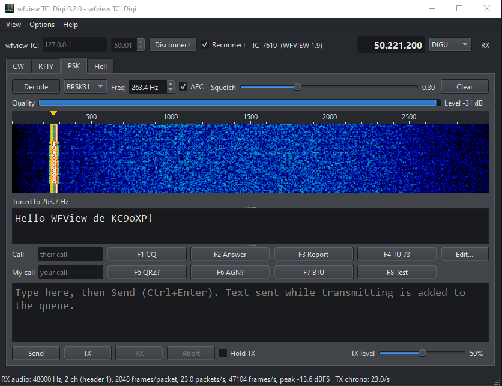
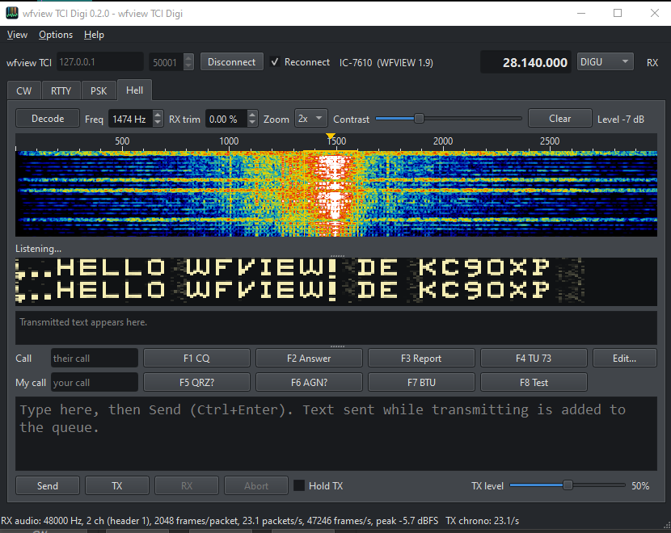
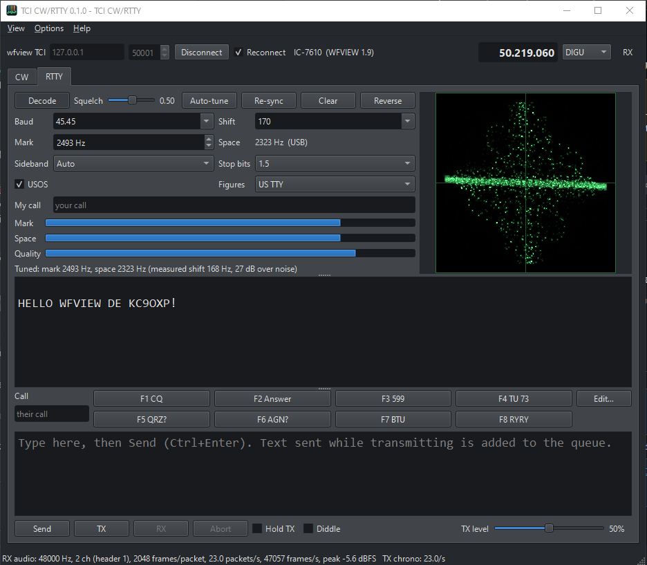
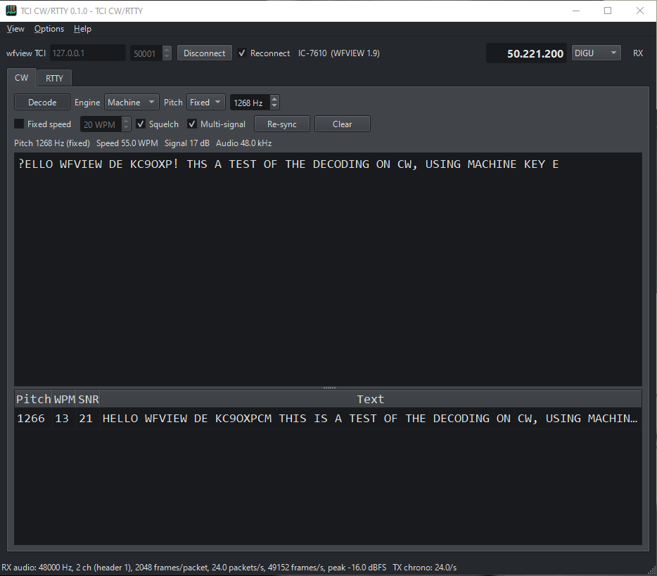
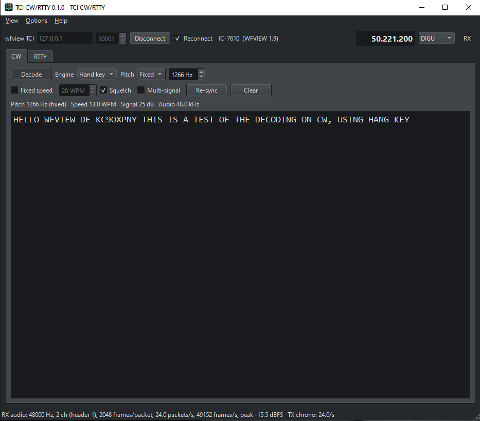

# wfview TCI Digi

> [!WARNING]
> **Alpha release: not fully developed and still very much in testing.**
> Expect bugs, rough edges and changes between versions. It has been tried on one
> station (IC-7610 with wfview v3) so far. When you transmit, start into a dummy load
> or at low power and keep an eye on the radio. Bug reports and test results are
> welcome in the Issues tab.



Stand-alone digital modes - CW decoder, RTTY, PSK (BPSK31/63/125) and Feld Hell -
that connect to **wfview** over **TCI**
(Transceiver Control Interface). wfview handles the radio; this program gets the
receive audio, sends transmit audio, and keys PTT, all through wfview's TCI server.
It works the same whether wfview reaches the radio over LAN or over USB, and it
should work with any other TCI server too.

> **Unofficial companion.** This is not (yet) part of the wfview project. It is
> offered to the wfview team for possible adoption; see *Future* below.

It started as the CW decoder and RTTY window proposed for wfview v3
(wf-group/wfview PRs #151 and #152). On #152, Elliott (W6EL) suggested building it
as a separate program that talks to wfview over TCI, so wfview v3 can ship without
it and wfview's TCI server gets a real client to test against.

## Features

**CW (receive)**
- Two decoders: *Machine* (ggmorse, for keyers and computer-sent CW) and *Hand key*
  (learns each sender's timing).
- Pitch: Auto (strongest steady tone, 200-1200 Hz) or Fixed (200-3000 Hz; Hand key is
  used above 1900 Hz).
- Auto or fixed speed, squelch, re-sync.
- Multi-signal list: every CW signal from 200 to 2000 Hz with its pitch, speed, SNR and
  text. Double-click a row to decode that station.

**RTTY (receive and transmit)**
- Any baud/shift (45.45/50/75/100 bd, 170/200/425/850 Hz presets), 1/1.5/2 stop bits,
  USOS, US TTY or ITA2 figures, Reverse.
- Mark/space filter demodulator with W7AY optimal ATC and a tone-contrast squelch.
- Crossed-ellipse tuning scope, mark/space/quality bars, Auto-tune (finds the tone
  pair in the last few seconds and sets Mark).
- Sideband **Auto**: follows the radio's mode (USB/DIGU or LSB/DIGL), so mark lands on
  the right tone without touching Reverse.
- AFSK transmit through TCI: 8 macros (F1-F8, `{MYCALL}`/`{CALL}`), type-ahead box,
  Hold TX, diddle, TX level, Esc to abort. 0.30 s of mark before the first character
  and 0.15 s after the last.
- Watchdogs release PTT if the server never asks for TX audio, the radio does not go
  to transmit, or the radio drops out of transmit (e.g. wfview's PTT timeout).
- Double-click a call in the receive pane to put it in the Call field.

**PSK (receive and transmit)**
- BPSK31, BPSK63 and BPSK125 with standard Varicode.
- Matched-filter receiver: carrier mixed to baseband, a two-symbol Hann filter,
  symbol timing from the envelope, differential phase decisions. Copies cleanly down
  to about -4 dB SNR in the signal bandwidth in the tests.
- Waterfall (0-3 kHz): click a signal to tune, the click snaps to the signal's
  centre; the mouse wheel fine-tunes 1 Hz.
- AFC (within one baud of where you tuned) and a phase-quality squelch with a
  quality bar.
- Transmit on the receive frequency: 32 symbols of idle reversals before the text,
  a short tail and a shaped fade-out after it, so no key clicks.
- Same macros, Call/My call, type-ahead box, Hold TX, TX level, Esc and watchdogs as
  RTTY.

**Feld Hell (receive and transmit)**
- Standard Feld Hell: 7-column characters, 14 half-pixels per column, 245 pixels a
  second (2.5 characters a second), shaped on/off keying (power more than 40 dB down
  outside +/-250 Hz).
- Receive is painted, not decoded, like every Hell program: each column is drawn
  twice, one copy above the other, so text that drifts up or down stays readable.
  Zoom 1-4x, contrast, RX trim to straighten slanted text.
- Waterfall with click-to-tune, macros (sent in capitals; the font has 59 characters),
  transmitted text shown in a strip below the picture.

Only one mode transmits at a time: starting a transmission in one tab stops any
other. *My call* is shared by all tabs.

**TCI**
- Frequency and mode shown and settable from the top bar.
- *View > TCI log*: connection messages plus a box to send raw TCI commands.
- The status bar shows the receive and transmit audio streams once a second
  (rate, channels, frames per packet, packets/s, peak level, how TX is paced). Handy
  for comparing wfview's LAN and USB audio paths.

## Screenshots

All taken on an IC-7610 with wfview v3 over TCI, receiving test signals.

| PSK (BPSK31) | Feld Hell |
|---|---|
|  |  |

| RTTY (0.1.0) | CW, Machine engine (0.1.0) |
|---|---|
|  |  |

| CW, Hand key engine (0.1.0) | |
|---|---|
|  | |

The RTTY and CW screenshots are from 0.1.0, when the program was called TCI CW/RTTY;
those tabs work the same in 0.2.0.

## Setting up wfview (v3)

wfview **v3** is required. wfview 2.24 answers TCI (the radio, frequency and mode
show up) but never sends TCI audio, so the status bar stays at "RX audio: none".

1. **Settings > External Control > TCI Server Port**: set a port to enable the TCI
   server (0 = disabled). The default is **50001**.
2. Set up wfview's receive audio as usual (LAN audio, or the radio's USB audio codec).
3. For transmit: tick **Settings > User Interface > Enable PTT Controls**, and put the
   radio in a data mode:
   **DIGU** (USB-D) or **DIGL** (LSB-D). PSK and Hell work on either sideband; PSK
   on USB-D is the usual convention. The program warns if the radio is in a mode that
   does not take computer audio.
4. Connect wfview to the radio (wfview refuses TCI clients while no radio is connected).
5. Start wfview TCI Digi, enter the computer running wfview (127.0.0.1 if it is the same
   one) and port, and press **Connect**. With *Reconnect* ticked it keeps retrying
   every 5 s, so it can be started before wfview.

## Building

Qt 6 (Widgets, WebSockets), a C++17 compiler.

```
mkdir build && cd build
qmake ../wfview-tci-digi.pro CONFIG+=release
make          # nmake with MSVC on Windows
```

Tests:

```
# Qt-free (protocol helpers, RTTY and CW through TCI frames)
g++ -std=c++17 -O2 -Isrc -Iengine tests/test_protocol.cpp src/tciprotocol.cpp engine/rttycore.cpp engine/rttytxsource.cpp -o test_protocol
g++ -std=c++17 -O2 -Isrc -Iengine -Iengine/ggmorse/include tests/test_cw.cpp src/tciprotocol.cpp engine/ggmorse/src/ggmorse.cpp engine/ggmorse/src/resampler.cpp -o test_cw
# PSK and Feld Hell modems (loopback at several speeds, sample rates, offsets and noise)
g++ -std=c++17 -O2 -Iengine tests/test_psk.cpp engine/pskcore.cpp -o test_psk
g++ -std=c++17 -O2 -Iengine tests/test_hell.cpp engine/hellcore.cpp -o test_hell

# End to end against a mock of wfview's TCI server (~90 s)
qmake ../tests/test_e2e.pro && make && QT_QPA_PLATFORM=offscreen ./test_e2e
```

`test_e2e --serve 50001` runs only the mock server, which plays an RTTY station
(2125/2295 Hz), a BPSK31 station (1000 Hz) and a Feld Hell station (500 Hz), and
decodes the RTTY and BPSK31 you transmit, so the program can be tried without a radio.

## Notes on wfview's TCI server (v3, November 2026)

Found while writing this client; the client works around each one.

- **RX audio header channel count.** wfview announces `audio_stream_channels:2` and sends
  interleaved stereo (2048 frames = 4096 floats per packet), but writes `channels = 1`
  in every RX audio frame header. A client that trusts the header reads the stream as
  mono at half speed (decoded RTTY is garbage). This client trusts the announced count
  when the server is wfview.
- **TX audio format is fixed.** wfview's TCI TX input expects 48 kHz stereo float32 and
  ignores the TX frame's header (rate, channels). This client always sends that.
- **TX pacing.** wfview sends a TX chrono frame only in front of each RX audio frame.
  If RX audio stopped while transmitting, so would the chrono frames; this client then
  paces TX audio from its own clock (the status bar says which is in use).
- `modulations_list` reports FM as `FM`, but `modulation` reports it as `nfm`.
- TCI has no command for the radio's CW pitch, so the CW decoder has no "follow radio
  pitch" mode here.

## Future

- More modes (QPSK31, MFSK, Olivia are candidates), each as a Qt-free engine with
  tests, the same way the CW, RTTY, PSK and Hell engines are written.
- The goal is for this to become part of wfview if it fits the wfview team's plans:
  as a companion program in the wf-group organization, as a second program built
  from the wfview tree, or folded back into wfview itself after v3. The engines have
  no Qt dependency and the code follows wfview's `.clang-format`, Qt version, qmake
  build and GPLv3 license, so any of these should be straightforward.

## License

GPLv3 (see LICENSE). The CW and RTTY engines come from the author's wfview work.
The PSK and Feld Hell engines and the 5x7 Hell font were written for this program.
`engine/ggmorse` is ggmorse by Georgi Gerganov, MIT license (see its LICENSE).
